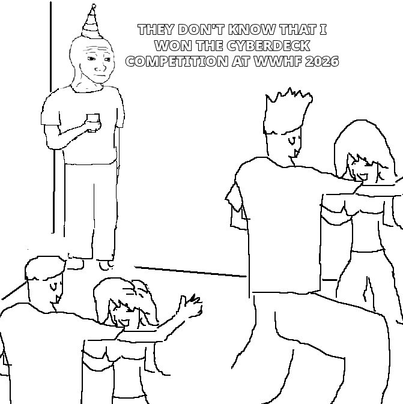

I went to WWHF this year and had a blast. My team consisting of four of seven 
[NoCo Hackers](https://nocohackers.com) members in attendance was in 2nd place 
in the CTF at the end of the first night, after a bit of a roller coaster we 
ended up in 6th (_technically_ in a four way tie for third, but there was also a two way tie for second). In addition to this success, I won the cyber deck competition! 

I should note that there were only three contenders, but I'm pretty happy with my little device.

## Hardware

* [Waveshare ESP32-P4-Pico](https://www.waveshare.com/esp32-p4-pico.htm?sku=32101)
* 18650 battery + [cheap holder/charge controller](https://a.co/d/04I0C0LZ)
* A cheap [SSD1322 OLED](https://a.co/d/01ZzCeE9)
* M5Stack [Card KDB v1.1 keyboard](https://shop.m5stack.com/products/cardkb-mini-keyboard-programmable-unit-v1-1-mega8a)
* Two random momentary press switches

## Case

The case was designed in freecad, due to the intracies of the keyboard, I used Haruki Toreda's [CardKB case](https://www.printables.com/model/997821-cardkb-case-i2c-keyboard) as my base model and built my case around it. This likely saved me hours of work, so a huge shout out to them. 

