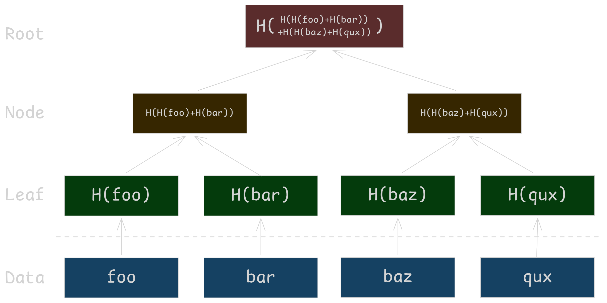
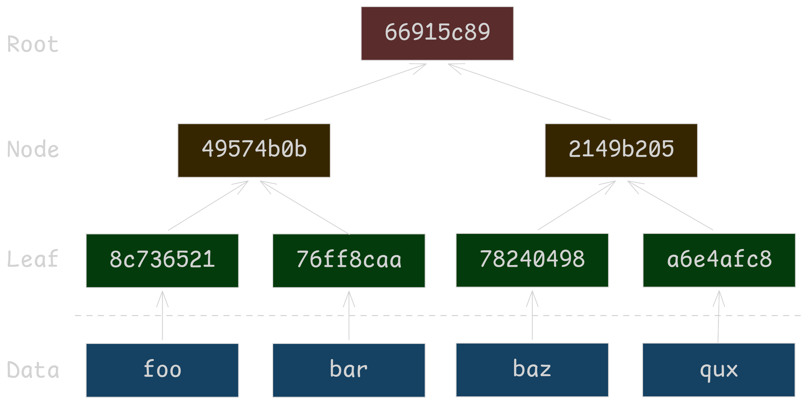
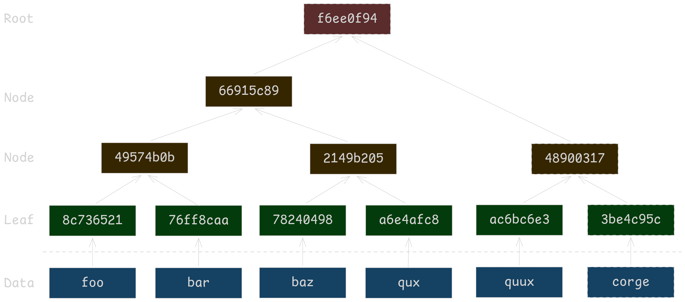
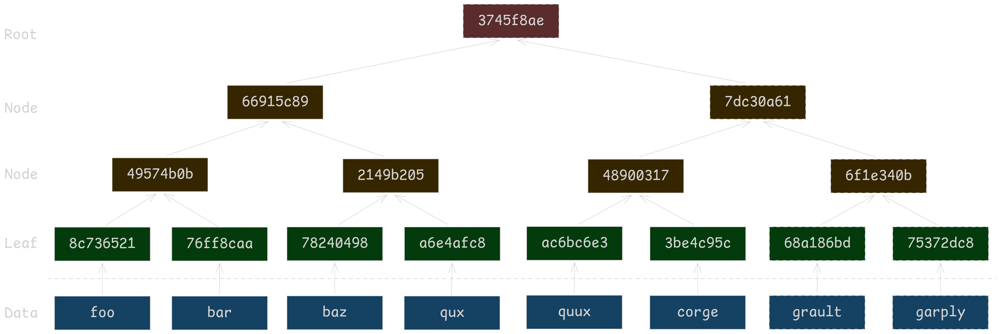
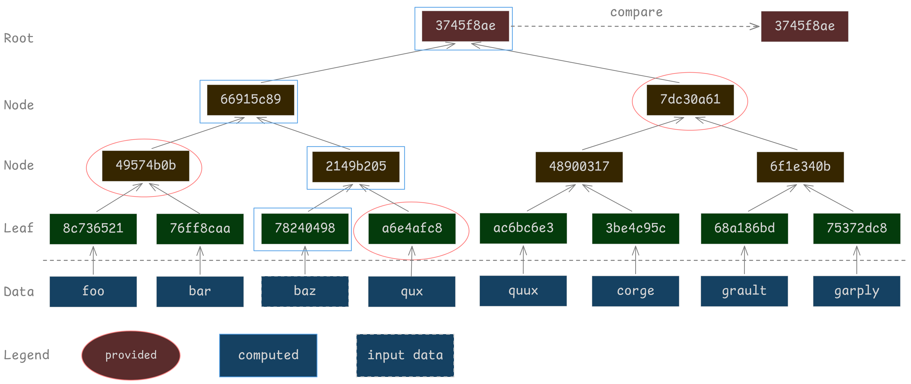
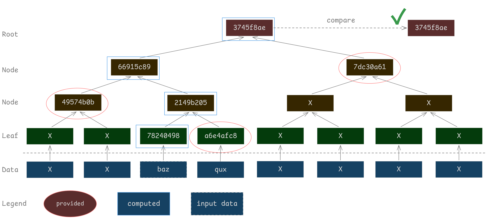
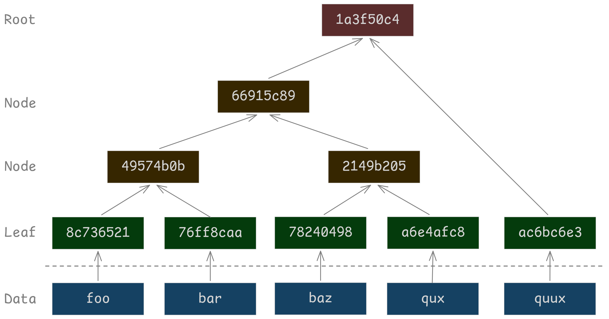

Merkle Trees are a simple, elegant and useful data structure when you need to validate that something is part of an underlying set of data, while minimizing the amount of data you need to verify when proving inclusion.

## Building Merkle Trees

This series covers the append only binary tree variant of Merkle Trees as used by [certificate transparency](https://www.rfc-editor.org/info/rfc9162/) with the goal of building enough intuition to understand both certificate transparency and [Merkle Tree Certificates (MTC)](https://datatracker.ietf.org/doc/draft-ietf-plants-merkle-tree-certs/). Other variants of Merkle Trees are used by systems like the bitcoin ledger and the ZFS file system. For a more academic introduction, see The Handbook of Applied Cryptography chapter 13.4.1 (this happens to be one of the [sample chapters](https://cacr.uwaterloo.ca/hac/about/chap13.pdf)!).

::: gallery










:::

I've purposely chosen a non-cryptographic hash function (crc32) in the above example in order to make the tree fit in a smaller space and make it easy to follow along. CRC32 **cannot** protect integrity against deliberate manipulation and must **not** be used for cryptographic purposes. If you'd like to build the tree by hand, you can use this bash function to compute the hashes. This is portable-ish. My Fedora 44 system shipped with GNU `cksum`, your box may not.

```bash
_crc_raw() {
    cksum -a crc32b | { read -r sum _; printf '%08x\n' "$sum"; }
}

crc() {
    if [ "$1" = -x ]; then
        shift
        local h
        if [ $# -gt 0 ]; then h=$(printf '%s' "$@"); else h=$(cat); fi
        h=${h//[[:space:]]/}
        if [[ ! $h =~ ^([0-9a-fA-F]{2})*$ ]]; then
            echo "crc: -x needs an even number of hex digits" >&2
            return 1
        fi
        printf '%b' "$(sed 's/../\\x&/g' <<<"$h")" | _crc_raw
    else
        if [ $# -gt 0 ]; then printf '%s' "$@"; else cat; fi | _crc_raw
    fi
}
```

Once you've pasted it into your shell it works as follows:

To hash a string `crc foo` yields `8c736521`. To hash hex formatted bytes `crc -x 8c736521`, which yields `849f8f2a`. You can pass in multiple values for instance `crc -x 8c736521 76ff8caa`, which concatenates the bytes prior to hashing, this yields `49574b0b`. So while following along, hash input data without the `-x`, hash sibling nodes to generate parent nodes with the `-x`.

A few notes about the construction of this tree:

* Height of the tree is `h=ceiling(log_2(n))` where _n_ is the total number of leaves and height is the number of edges on the longest root-to-leaf path.
* The exact way the hash function is applied isn't quite accurate for Merkle Tree Certificates in this example. Merkle Tree Certificates concatenate `0x01` before calculating internal node hashes `H(0x01 || left child hash || right child hash)` and `0x00` before calculating leaf hashes `H(0x00 || cert_data)`. This is done for [domain separation](https://en.wikipedia.org/wiki/Domain_separation), a common principle applied to many hashed structure implementations.

## Proof of Inclusion

Proving an object is included in a Merkle Tree requires relatively little data. If we have an object, we need the hash of its sibling, the hash of its parent's sibling and so on, up to the root. This means we need at most `h = ceiling(log_2(n))` hashes, along with left/right ordering to recompute a root hash for comparison against an authenticated root. 

:::gallery




:::

## Proof of Consistency

When dealing with Merkle Trees it is useful to be able to validate that the current state of a tree is consistent with the previous state of the tree. This can be done very efficiently. Given the previous root hash and tree size (defined as the number of leaves) the consistency proof is at most `ceiling(log_2n) + 1` hashes (where n is the number of leaves), but in many circumstances it's less than that. Given a previous tree size of _m_, a current tree size of _n_ and _k_ the largest power of two smaller than _n_ we have three scenarios to consider.[^mnk]

In all cases verification must establish agreement with the stored old root and the new root.

1. _m_ = _k_ in this scenario, the previous tree consists of the complete subtree of the left child of the new root. Validating consistency only requires the new right child and we can confirm the new root by calculating `H(stored root || provided right hash)`.
2. _m_ > _k_ the old tree already had the complete left child of the new tree and a prefix of the new right subtree. We are provided the intermediate hashes of the right tree and the root hash of the left subtree, then we can recursively validate that a) our old root can be calculated from the left subtree root and the provided right intermediate hashes and b) that the new root hash can be calculated from the left subtree root and the right intermediate hashes. Then we store the new root hash and tree size.
3. _m_ < _k_ the old tree is entirely contained in the left child of the new tree. We are provided with intermediate hashes for both the left subtree and root of the right subtree. We recursively verify the left subtree and ensure that we can recalculate our old root hash, then we calculate the new root from the new left and right child hashes and finally store the new root hash and size. 

:::gallery 




![m=5, n=6 so k is still 4. m>k tells the verifier that the left subtree was complete, but the root will have changed. We are provided with the two intermediate hashes from the right subtree (`ac6bc6e3` and `3be4c95c`) and the root of the left subtree (`66915c89`). First, we verify we can reconstruct the old root using the left subtree root `crc -x 66915c89 ac6bc6e3`. Then we reconstruct the new right subtree using the right intermediate hashes `crc -x ac6bc6e3 3be4c95c` and finally we reconstruct the new root `crc -x 66915c89 48900317`. If this all checks out, we store the new root along with size and signature.](media/merkle_consistency2.png)


![m=4, n=9 so k is now 8. m<k tells the verifier that the old tree is entirely contained in the left child of the new tree. We now have a new root, the left subtree has a new root and the right subtree is brand new. We are provided with the sibling of our old root (`7dc30a61`) and the root of the right subtree (`931bbb8a`). First we can calculate the new left subtree root by hashing our old root and its sibling: `crc -x 66915c89 7dc30a61` this gives us `3745f8ae` which is the new left subtree root. Then we can calculate the new root by taking the left subtree root we just calculated and the root of our right subtree `crc -x 3745f8ae 931bbb8a`. If this checks out, we store the new root along with the size and signature.](media/merkle_consistency3.png)

:::

An inclusion proof tells us an object belongs to a tree represented by a root hash. A consistency proof tells us the older tree's entries remain an unchanged prefix of the newer tree. Authentication of that root and integrity of an overall tree are different problems. In the next article we'll look at how Certificate Transparency addresses those problems.

---
### changelog
2026-11-17: added consistency proof section and examples. Updated the height definitions to always be based on the number of leaves instead of the number of nodes.

---

[^mnk]: For all 0 < _m_ < _n_
