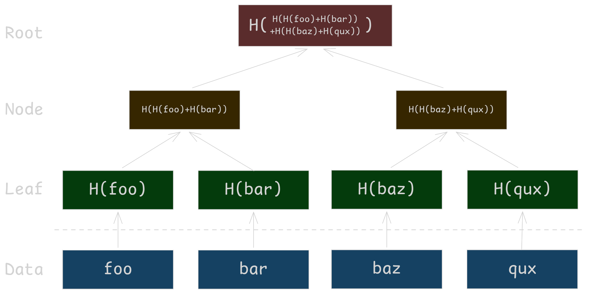
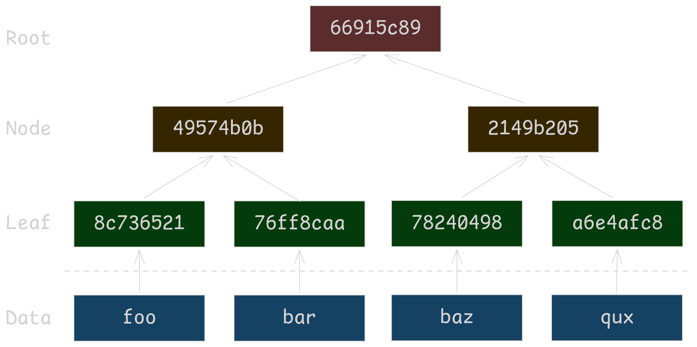
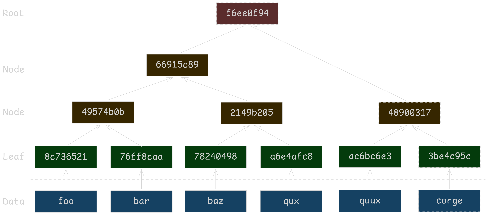
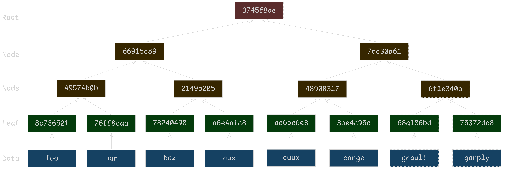
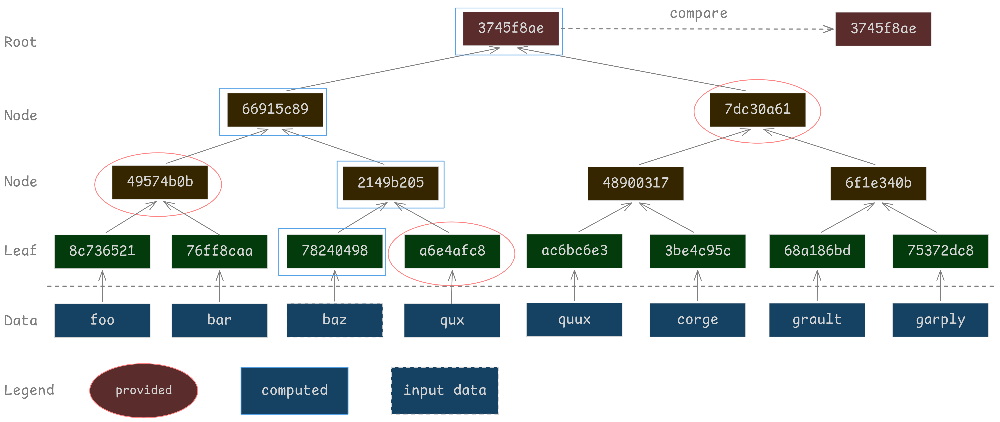
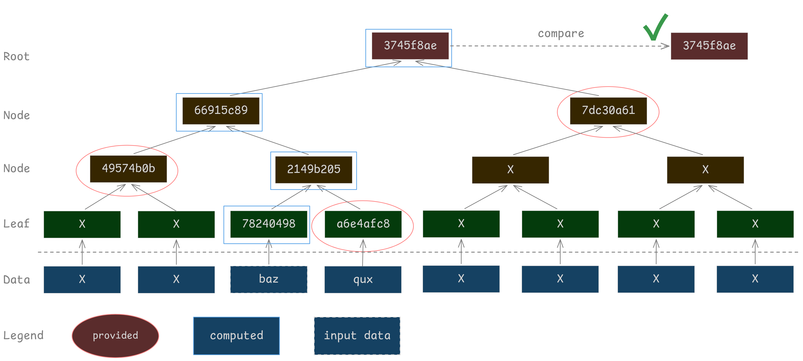

Merkle Trees are a simple, elegant and useful data structure when you need to validate that something is part of an underlying set of data, while minimizing the amount of data you need to verify when proving inclusion.

## Building Merkle Trees

This series covers the append only binary tree variant of Merkle Trees as used by [certificate transparency](https://www.rfc-editor.org/info/rfc9162/) with the goal of building enough intuition to understand both certificate transparency and [Merkle Tree Certificates (MTC)](https://datatracker.ietf.org/doc/draft-ietf-plants-merkle-tree-certs/). Other variants of Merkle Trees are used by systems like the bitcoin ledger and the ZFS file system. For a more academic introduction, see The Handbook of Applied Cryptography chapter 13.4.1 (this happens to be one of the [sample chapters](https://cacr.uwaterloo.ca/hac/about/chap13.pdf)!).

::: gallery










:::

I've purposely chosen a non-cryptographic hash function (crc32) in the above example in order to make the tree fit in a smaller space and make it easy to follow along. CRC32 **cannot** protect integrity against deliberate manipulation and must **not** be used for cryptographic purposes. If you'd like to build the tree by hand, you can use this bash function to compute the hashes. This is portable-ish. My Fedora 44 system shipped with GNU `cksum`, your box may not.

```bash
_crc_raw() {
    cksum -a crc32b | { read -r sum _; printf '%08x\n' "$sum"; }
}

crc() {
    if [ "$1" = -x ]; then
        shift
        local h
        if [ $# -gt 0 ]; then h=$(printf '%s' "$@"); else h=$(cat); fi
        h=${h//[[:space:]]/}
        if [[ ! $h =~ ^([0-9a-fA-F]{2})*$ ]]; then
            echo "crc: -x needs an even number of hex digits" >&2
            return 1
        fi
        printf '%b' "$(sed 's/../\\x&/g' <<<"$h")" | _crc_raw
    else
        if [ $# -gt 0 ]; then printf '%s' "$@"; else cat; fi | _crc_raw
    fi
}
```

Once you've pasted it into your shell it works as follows:

To hash a string `crc foo` yields `8c736521`. To hash hex formatted bytes `crc -x 8c736521`, which yields `849f8f2a`. You can pass in multiple values for instance `crc -x 8c736521 76ff8caa`, which concatenates the bytes prior to hashing, this yields `49574b0b`. So while following along, hash input data without the `-x`, hash sibling nodes to generate parent nodes with the `-x`.

A few notes about the construction of this tree:

* Height of the tree is `h=ceiling(log_2(n+1))-1` where n is the total number of nodes and height is the number of edges on the longest root-to-leaf path.
* The exact way the hash function is applied isn't quite accurate for Merkle Tree Certificates in this example. Merkle Tree Certificates concatenate `0x01` before calculating internal node hashes `H(0x01 || left child hash || right child hash)` and `0x00` before calculating leaf hashes `H(0x00 || cert_data)`. This is done for [domain separation](https://en.wikipedia.org/wiki/Domain_separation), a common principle applied to many hashed structure implementations.

## Proof of Inclusion

Proving an object is included in a Merkle Tree requires relatively little data. If we have an object, we need the hash of its sibling, the hash of its parent's sibling and so on, up to the root. This means we need at most `h = ceiling(log_2(n+1) - 1)` hashes, along with left/right ordering to recompute a root hash for comparison against an authenticated root. 

:::gallery




:::

An inclusion proof tells us an object belongs to a tree represented by a root hash. Authentication of that root and integrity of an overall tree are different problems. In the next article we'll look at how Certificate Transparency addresses those problems.
