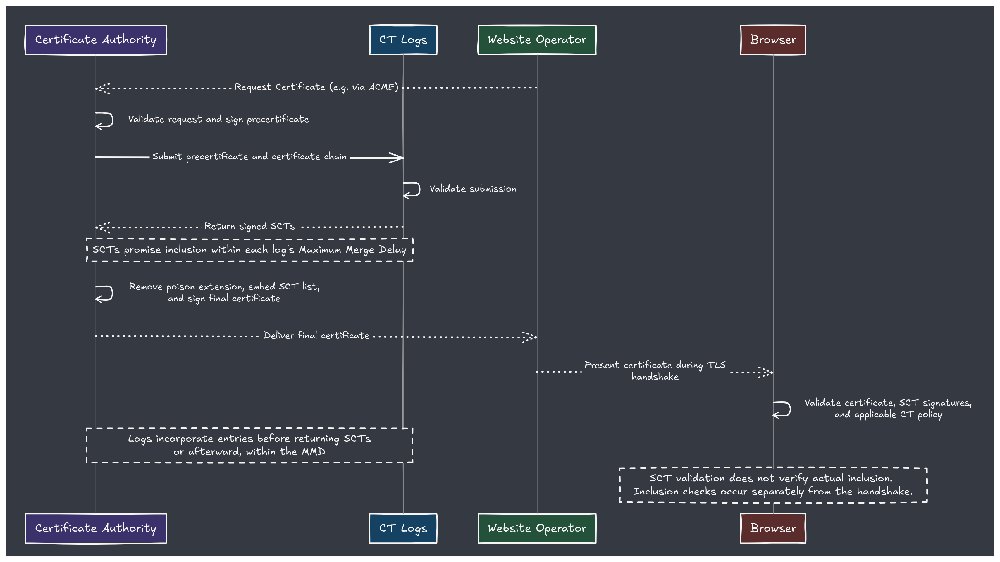
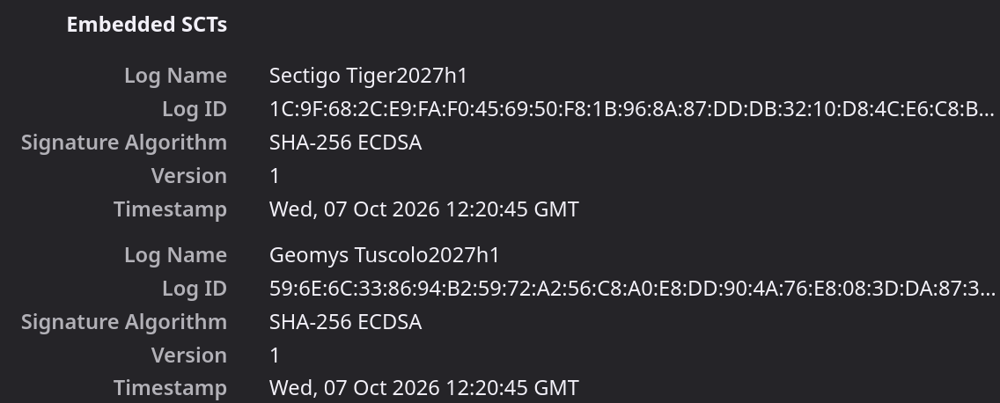
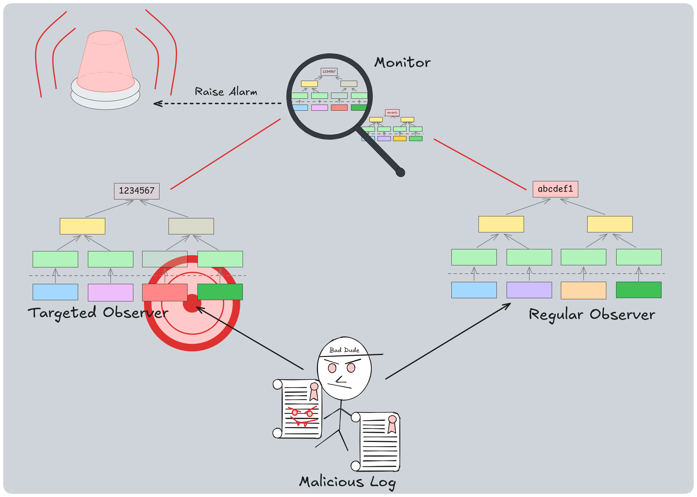
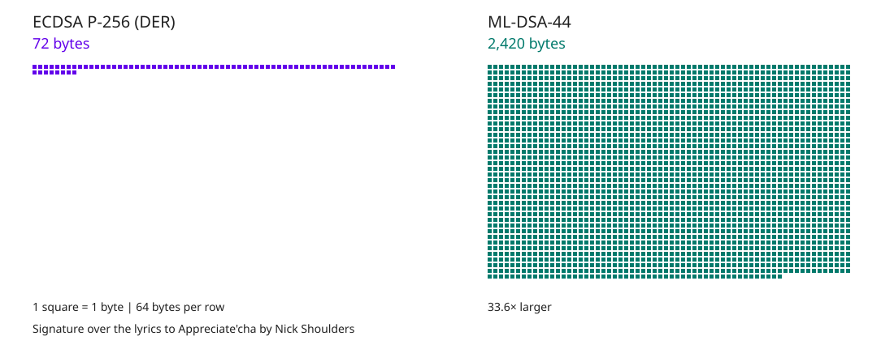

Certificate Transparency (CT) was introduced in 2013 as a response to the DigiNotar breach[^DigiNotar]. [RFC 6962](https://www.rfc-editor.org/info/rfc6962/) was published in June 2013 and was officially superseded by [RFC 9162](https://www.rfc-editor.org/info/rfc9162/) in 2021. However, its CT v2 protocol has not seen widespread deployment. Root programs and log operators have moved towards [static CT logs](https://c2sp.org/static-ct-api@v1.1.0)[^apple_sunset], which retain RFC 6962's precertificate/SCT model while replacing the read API. Starting in 2027 the Chrome root program plans to begin Merkle Tree Certificate bootstrapping. Because of this, I'll cite RFC 6962 throughout this article instead of 9162. 

## The Problem

Browsers trust many CAs[^ca_count] and unconstrained publicly trusted CAs can issue certificates for any domain[^caa_records]. If an attacker manages to compromise a single CA in a major root store's program, this could lead to a bad day for the internet. 

CT makes issuance publicly observable. This means misissuance is still possible, but CT monitors can catch it when it occurs. 

## Approach

Issuance following the introduction of RFC 6962 involves several parties. 

1. The Certificate Authority (CA) which validates requests and provides DV, OV or EV certificates.
2. CT Logs, which record certificate information in an append-only Merkle Tree.
3. Browsers and Operating systems which enforce their applicable trust-store and CT policies.[^bugzilla]
4. [CT Monitors](https://www.rfc-editor.org/rfc/rfc6962.html#section-5.3) watch logs for suspicious issuance and [CT Auditors](https://www.rfc-editor.org/rfc/rfc6962.html#section-5.4) verify inclusion of entries and consistency between log snapshots. In practice the lines are blurry between these two roles.

### Process during issuance

1. The CA prepares a signed pre-certificate[^precert].
2. The CA submits the pre-certificate to CT logs[^ct-logs].
3. The logs return Signed Certificate Timestamps (SCTs). SCTs can be thought of as a promise to log the certificate within the log's published Maximum Merge Delay.
4. The CA issues a final certificate with the poison extension field excluded. SCTs are made available to clients either by SCTs embedded in the certificates, OCSP stapling or in a `signed_certificate_timestamp` TLS extension.

::: gallery

:::

### Post-issuance monitoring and auditing

Certificate Transparency is really just getting started when issuance is finished. You may have noticed that there are still two roles that haven't been covered yet. 

#### Browsers and Operating Systems

SCTs are delivered to clients via embedding in the certificate, OCSP stapling or in the TLS handshake via the `signed_certificate_timestamp` extension. Clients verify SCT signatures against the corresponding logs' public keys and ensure the SCTs meet the applicable browser or OS CT policy. These checks are performed in addition to normal certificate validation. However, SCTs only verify that the log promised to include the certificate in the log, not that it was actually included.

#### CT Monitors/Auditors

 CT Monitors can fetch log entries and look for unexpected issuance and alert domain owners if they find issues. Some of these also play an audit role and verify cryptographic integrity, append-only behavior and validate inclusion of certificates following the log's Maximum Merge Delay. 

 You can find a list of CT monitors [here](https://certificate.transparency.dev/monitors/). It's worth noting that not all CT monitors play an active audit role, some act more like looking glass servers and only provide searchable interfaces for log data without additional audit functions. 

### Dealing with conflicting views

In theory, a malicious log could present a different view of their CT log to different monitors to hide misissuance. The RFC authors originally suggested addressing this via a "gossip" mechanism in which clients exchange STHs with each other to detect bad behavior. The [RFC leaves](https://www.rfc-editor.org/rfc/rfc6962#section-9) the gossip mechanism unspecified. 

In practice, Chrome does some [sampled SCT auditing](https://chromium.googlesource.com/chromium/src/+/HEAD/services/network/sct_auditing/README.md) which could expose misissued certificates being presented to a subset of users and unhonored logging promises. In the future, Merkle Tree Certificates (covered in the next article) may address this via [cosigning](https://www.ietf.org/archive/id/draft-ietf-plants-merkle-tree-certs-08.html#section-5.3).

### CT Log Structure

In the [prior article](https://cyb3r.sh/2026-11-11-merkle-trees.html) we established the rough shape of Merkle Trees used by CT logs. The CT RFCs make a few additional distinctions.

1. [Signed Tree Head (STH)](https://www.rfc-editor.org/rfc/rfc6962.html#section-3.5) is a structure signed by the CT log consisting of the root hash, tree size and timestamp.
2. [Inclusion Proof](https://www.rfc-editor.org/rfc/rfc6962.html#section-2.1.1) is the shortest list of additional nodes required to compute the Merkle Tree hash for a given tree from a particular leaf. 
3. [Consistency Proof](https://www.rfc-editor.org/rfc/rfc6962.html#section-2.1.2) is used to show that an older checkpoint's entries remain an unchanged prefix of a newer checkpoint. 
4. [Leaf Input Data](https://www.rfc-editor.org/rfc/rfc6962.html#section-3.4) for pre-certificate entries is a structure consisting of reconstructed certificate to be signed (TBSCertificate), issuer-key hash, timestamp and extensions. Logs _can_ also contain final-certificate entries.

Certificate Transparency makes issuance observable, but SCT validation alone checks a promise of inclusion rather than the inclusion itself. Meanwhile, post-quantum public keys and signatures substantially increase certificate and handshake sizes. Merkle Tree Certificates (MTCs) integrate transparency into certificate authentication and use signed tree structures instead of individual signatures stored with each certificate reducing overhead. In the next article we'll explore that design and Chrome's bootstrapping planned to begin in 2027.

:::gallery

:::

[^DigiNotar]: In 2011 DigiNotar was compromised, the attackers used their access to issue fraudulent certificates for major domains including \*google.com, \*skype.com and update.microsoft.com. The fraudulent Google certificates were used to target Iranian users. This is well documented and worth an online search if you're unfamiliar. 
[^apple_sunset]: On November 5, 2026, Apple [announced](https://groups.google.com/a/chromium.org/g/ct-policy/c/XvCEH84kVXw) that they would no longer require that at least one SCT must be issued from a log compliant with RFC 6962. This effectively ended the requirement that non-static CT logs must be used by CA operators. It should be noted that static CT logs use RFC 6962 conventions for writes, but use a different storage mechanism and read path. 
[^ca_count]: At time of writing, Google Chrome's root store program lists 44 distinct CA organizations (based on CCADB data). [CCADB](https://www.ccadb.org/resources) provides up-to-date information on each browser and OS root program.
[^caa_records]: CAA records allow domain owners to specify which CAs are authorized to issue certificates for their domain. However, CAs are responsible for checking CAA records at issuance time and not all domains publish CAA records, so this isn't a perfect system. It's easy to imagine scenarios where a compromised CA would ignore CAA records.
[^bugzilla]: While each root store program is independent, Mozilla's [Bugzilla](https://bugzilla.mozilla.org/buglist.cgi?product=CA%20Program&bug_status=__open__) tracker is the de facto mechanism for reporting incidents involving CA adherence to CAB Forum Baseline Requirements or individual CAs' Certificate Policy and Certification Practice Statements
[^precert]: This is essentially a copy of the certificate all fields populated except the Signed Certificate Timestamps (SCTs) and the addition of a critical "poison" extension field that prevents the pre-certificate from being trusted by TLS clients.
[^ct-logs]: CAs submit the pre-certificates to multiple independent logs for redundancy and to satisfy CT policy. 
