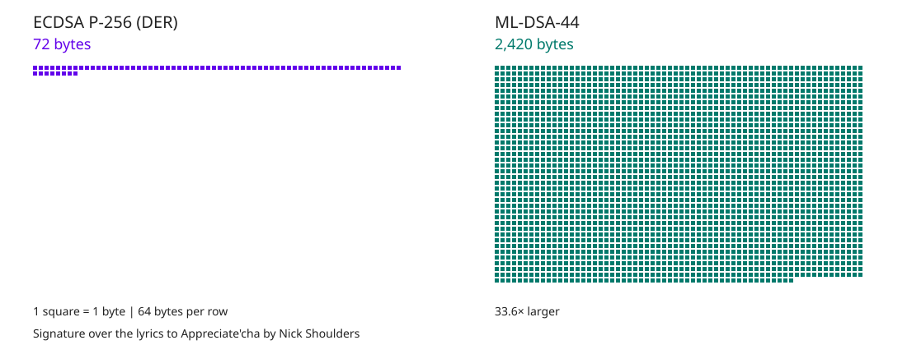
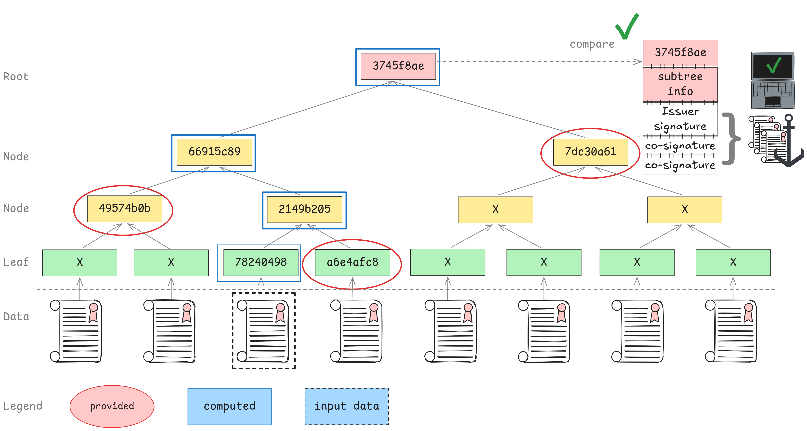
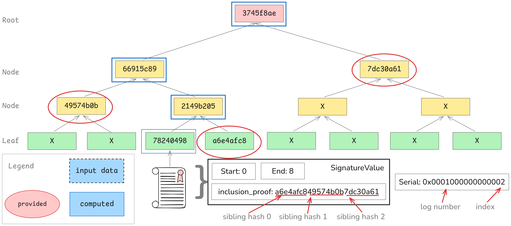
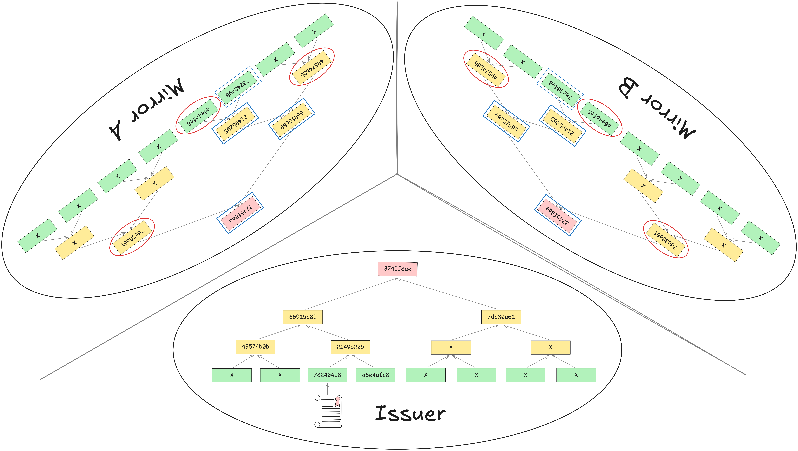

```
DISCLAIMER - this is a rough draft being published early so folks can follow along at NoCo Hackers! I'll keep the publication date the same when I merge the final changes, but will add a changelog at the bottom giving a high level overview of what all was changed between the inital publication and the final edits. 
```

## The Problem: Post-Quantum Signature Overhead

I left off the last article with the following image

:::gallery

:::

To be clear, the issue we'll have in the future isn't just one signature. It's multiple signatures. 

1) The certificate itself is signed by the CA
2) The CA signs intermediate certificates
3) CT logs sign SCTs

In the above graphic we saw a signature size increase of 33.6x, this gives you a rough idea of how much we should anticipate each of these signatures to grow. Your web browser does a whole lot of TLS handshakes each time it connects to a new site[^reddit]. 

It is worth calling out that the server's public key is still carried in the TLS certificate and is still used to verify the server's handshake signature. However, the certificate's authentication and how we verify the certificate itself is trustworthy changes with MTCs. 

Throughout this document I'll be citing two primary resources. One is the [MTC draft specification](https://www.ietf.org/archive/id/draft-ietf-plants-merkle-tree-certs-08.html), this describes the underpinnings of Merkle Tree Certs. I'll also be using the [Chrome Root Program's draft Quantum-resistant Root Program Policy](https://googlechrome.github.io/chromerootprogram/cqrp/draft-policy/) (v0.4.0 at this time), while still a draft, this shows what the public PKI community is trending towards operationally[^crp-qr].

## From Signed Certificates to Signed Trees

In traditional TLS, your OS, browser and occasionally other applications have a set of trusted root certificates. These root stores are managed by individual root programs that set strict guidelines for inclusion. I roughly cover how chaining from an end-entity certificate, to an intermediate and finally a root certificate works in an [earlier article](./2026-05-20-intro_to_modern_cryptography.html#certificates). The one sentence version of this is: Your browser has a list of certificates containing public keys, those public keys are used to validate chains of certificates that ultimately establish that signatures on end-entity certificates are valid. 

MTCs retain the concept of a trust anchor, but use inclusion proofs to signed tree structures instead of direct signature chains on each certificate. 



## The Participants (under the current Chrome Root Program draft)

* Certificate Authorities[^rfc-sec5]
    * Issue certificates, operate their own issuance logs, mirror and cosign other CAs' logs
* Clients (Web Browsers, Operating Systems)[^rfc-sec7]
    * Verify inclusion proofs against trusted subtree information using either trusted signatures or previously trusted subtree information.
* Monitors[^rfc-sec10and12]
    * Detect and report misissuance and policy violations

## New certificate validation methods

Certificates presented to the client can either be a *Standalone MTC* or a *landmark-relative* certificate. The specific mechanisms for these are described in further detail later, but for now you should know:

1. Standalone MTCs can be used when a subtree isn't yet trusted by the client. In this case inclusion is verified against provided subtree data that has been signed by the issuing CA and cosigners. 
2. Landmark-relative certificates are validated by the client verifying an inclusion proof for a subtree they've previously trusted. A landmark is a structure from which trusted subtrees can be determined.

Which one is decided during the TLS handshake via a proposed [TLS trust anchors extension](https://datatracker.ietf.org/doc/html/draft-ietf-tls-trust-anchor-ids-07). This advertises to the TLS server which landmarks the client trusts.


## Issuing Merkle Tree Certificates

1. CA validates the request and prepares a certificate log entry
2. CA appends the entry to its issuance log
3. CA and mirroring cosigners authenticate consistent subtree information
4. CA constructs a standalone MTC with an inclusion proof and the required cosignatures.
5. A landmark-relative version is made available once a landmark containing the certificate exists.

## Verifying a Merkle Tree Certificate

1. Do all the normal checks, is the cert valid for the host we're connecting to for the reason we're connecting to it on the date we're connecting to it and does the server's handshake signature verify against the pubkey?
2. Reconstruct the log entry based on the data in the certificate, this includes relevant certificate fields, the pubkey algorithm and a hash of the pubkey. It's also worth noting with MTCs we also move away from random certificate serial numbers and instead encode the log number in the upper 16 bits of the serial and the entry's leaf index in the lower 48 bits. 
3. Verify the inclusion proof, using the certificate's position to calculate the subtree hash. Similar to what we covered in the [first article](./2026-11-11-merkle-trees.html). 
4. Authenticate the subtree. This differs depending on whether the server sent us a landmark-relative or standalone certificate.
    - Standalone: verify the required CA and additional cosigners signatures against our root of trust.
    - Landmark-relative: compare against a previously trusted landmark.
5. Perform revocation checks[^revocation]

### So when can we omit signatures?

Unfortunately, subtrees aren't added to a trust store automatically after a standalone MTC verification has succeeded. Instead, landmarks are periodically distributed to clients via out-of-band mechanisms. In the case of Chrome this will be Chrome's Landmark Service[^chrome-sec245].

Section 8.2 of the draft RFC specifies two methods for clients to pass their list of landmarks they trust to a TLS server:

*Single-Log Landmark Groups* - This specifies passing landmark information in a list where each CA's landmarks are provided as follows: `{ CA_ID, landmarkGroups(2), log_number, latest_landmark }`. I'll note that `landmarkGroups(2)` is an OID component and not a function. This ends up looking something like this schematically:

```
{ CAfoo, 2, Log#2, Landmark23 }
{ CAfoo, 2, Log#1, Landmark245 }
{ CAqux, 2, Log#4, Landmark42 }
```

Each ID covers active landmarks up to the stated number for that CA/log. This allows the server to derive the set of landmarks the client can verify. From there they can figure out which subtrees are considered trustworthy. 

*Timestamped landmark groups* - This specifies passing a predefined trust-anchor group, which can be one or more CAs followed by a version and tick number where `tick = (represented_time - start_time) / tick_duration`. This ends up looking like `groupOID.version.tick`. This tells the server which landmarks in a group were active at the represented time, so that it can determine whether to use standalone or landmark-relative certificates.

### Proof embedding

Proofs are embedded into the `signatureValue` field of the certificate[^mtc6_2]:

```
   opaque TrustAnchorID<1..2^8-1>;

   struct {
       TrustAnchorID cosigner_id;
       opaque signature<0..2^16-1>;
   } Cosignature;

   struct {
       MTCLogEntryExtension extensions<0..2^16-1>;
       uint48 start;
       uint48 end;
       opaque inclusion_proof<0..2^16-1>;
       Cosignature signatures<0..2^24-1>;
   } MTCProof;
```



Cosignatures are omitted in the case of landmark-relative certificates. Additionally, the signatureAlgorithm in the case of MTCs is `id-alg-mtcProof`. The `inclusion_proof` field is a concatenated list of sibling hashes. Note that the size of each hash is derived from the hash function used. Placement in the tree is derived from the leaf index (derived from the serial number) and the start and end fields (denoting the range of the subtree where the index lies)[^start_end]. 

## What Gets Smaller

* Individual CA signatures on end-entity certificates and separate signed SCTs are removed
* *Standalone MTCs*: carry inclusion proofs plus subtree cosignatures. So the savings depend on the algorithms, proof lengths and number of cosignatures
* *Landmark-relative MTCs*: Omit cosignatures, so only need to carry the proof 
* Proof size grows logarithmically. The exact size depends on where in the tree the certificate is placed, but at most `ceiling(log_2n)` for reference that's at worst 30 hashes (960 bytes assuming SHA-256) for a tree of 1,000,000,000 leaves. In practice 1,000,000,000 leaves in a subtree feels unlikely. 

## Consistency, Cosigners and Conflicting Views

Inclusion proofs establish membership in a tree, but they don't establish that everyone sees the same tree. Cosigning and mirroring help bridge that gap by following consistent log histories and signing subtree information. Unlike the existing CT scheme, Chrome's proposed policy dictates that independent mirrors verify log consistency, retain publicly accessible copies and cosign checkpoints. Certificate authentication is now tied to cosigner attestation rather than a single CA's signature. 



Different cosigners could still be shown different histories, however, client policies and monitors comparing checkpoints could help prevent or expose conflicting views. Exact mechanisms for this have not yet been specified.

[^reddit]: Hit F12 go to the network pane and load reddit. Look at the number of domains your browser is accessing to load just a single page! This isn't quite fair because of session resumption and connection reuse, but think of the worst case scenario!
[^crp-qr]: I'm using chrome's root program as the example here because they have been spearheading this work. The community could ultimately go in a different direction. It's also worth noting that apple has publicly [announced](https://groups.google.com/a/chromium.org/g/ct-policy/c/QGZw2ADMXvk) that they are moving in a similar direction, but they haven't made as many details available yet. 
[^rfc-sec5]: CA behavior is in [section 5 of the draft](https://www.ietf.org/archive/id/draft-ietf-plants-merkle-tree-certs-08.html#section-5) and Chrome Root Program expectations are in [section 2 of their draft policy](https://googlechrome.github.io/chromerootprogram/cqrp/draft-policy/#2-minimum-requirements-for-mtc-ca-operators)
[^rfc-sec7]: Client behavior is specified in [section 7 of the draft](https://www.ietf.org/archive/id/draft-ietf-plants-merkle-tree-certs-08.html#section-7)
[^rfc-sec10and12]: Monitor behavior is described in section [10](https://www.ietf.org/archive/id/draft-ietf-plants-merkle-tree-certs-08.html#section-10) and [12](https://www.ietf.org/archive/id/draft-ietf-plants-merkle-tree-certs-08.html#section-12) of the draft
[^revocation]: Revocation mostly doesn't change with MTCs, it still takes place via OCSP/CRL checking. However, the MTC CA extension does contain a minSerial and maxSerial field. Certificates outside of that range are rejected.
[^chrome-sec245]: Seen [here](https://googlechrome.github.io/chromerootprogram/cqrp/draft-policy/#245-criteria-for-chrome-usability) reading between the lines a bit it's implied this will distribute landmarks to chrome on a regular basis, but it doesn't outright say that. 
[^start_end]: start is inclusive, end is exclusive
[^mtc6_2]: [section 7 of the draft](https://www.ietf.org/archive/id/draft-ietf-plants-merkle-tree-certs-08.html#section-6)
