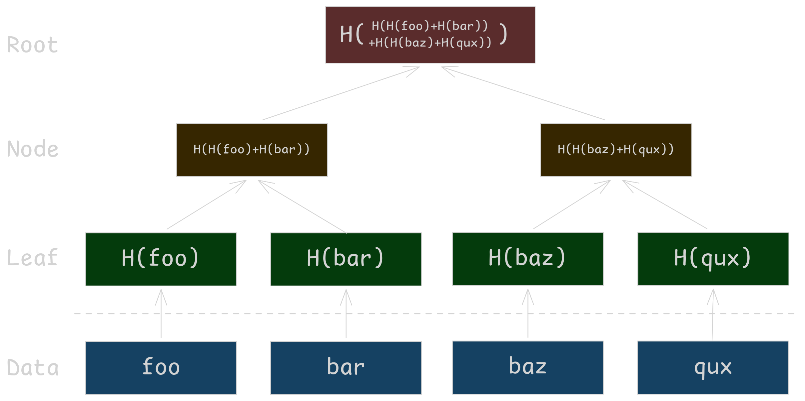
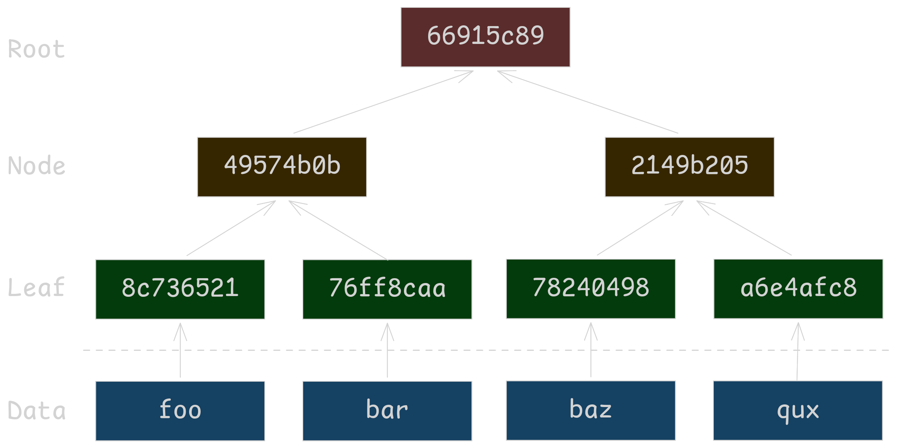
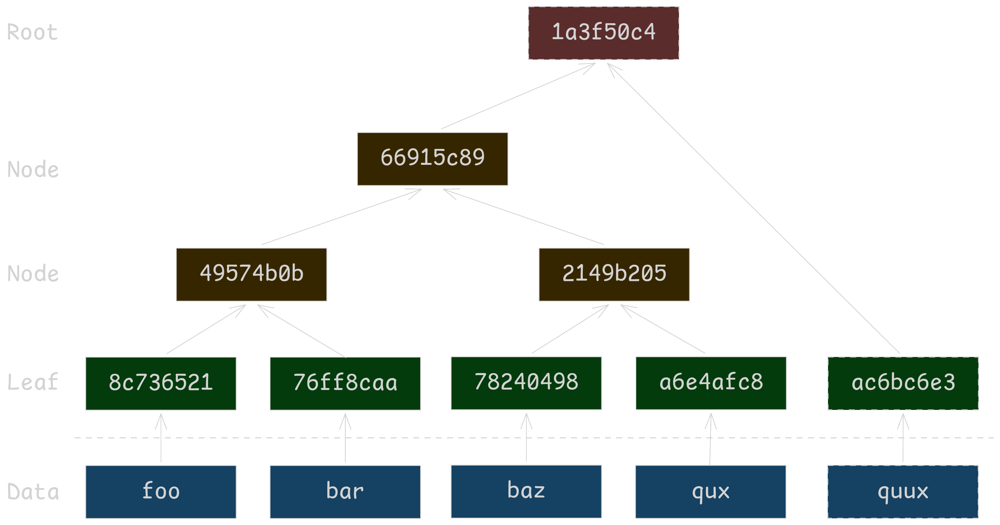
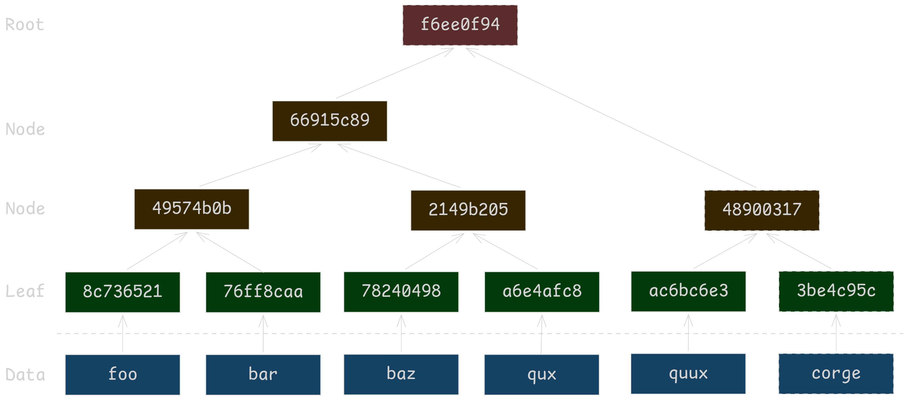
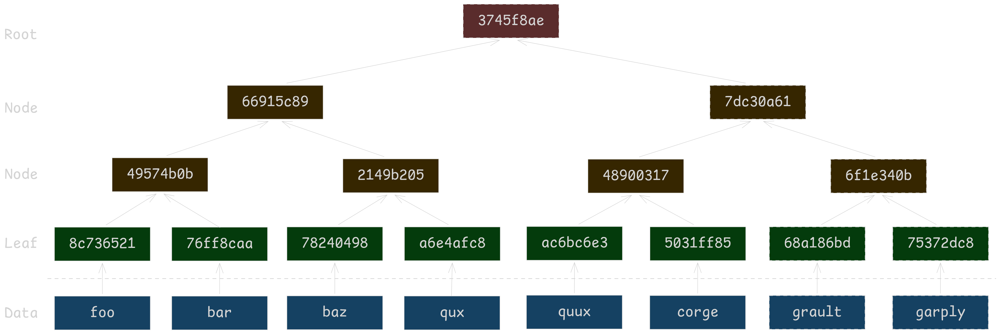
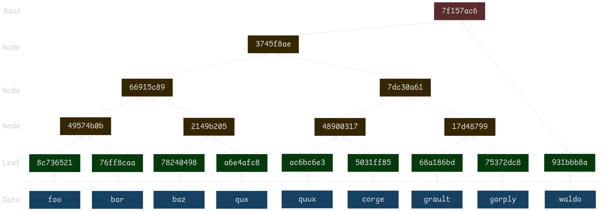

Merkle Trees are a simple, elegant and useful data structure when you need to validate that something is part of an underlying set of data, while minimizing the amount of data you need to send transmit during verification. <!--TODO expand on why this is better than signatures-->

# Building Merkle Trees

Merkle Trees are a binary tree structure with slightly different insertion and update rules. In general Merkle Trees work best for append only systems, which is why we see them used by certificate transparency logs <!--TODO RFC Link--> and by the bitcoin ledger. There are slight implementation details between these two usecases that I'll skip over for now. 

::: gallery

:::
